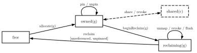
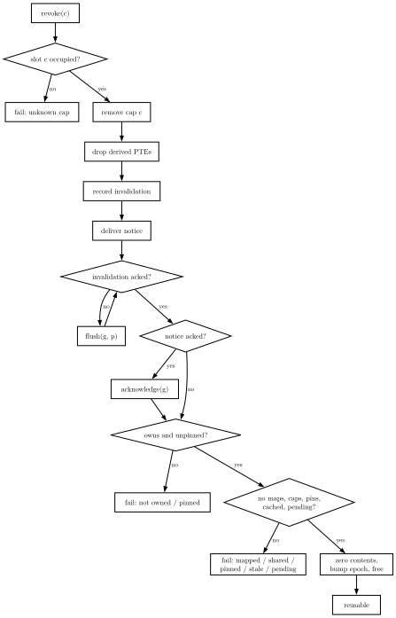

 Lean 4 model of hypervisor physical page ownership. It has an
executable transition system, a two level page table and MMU, an event
and scheduler layer and machine checked isolation theorems

Mappings are a two level `PageTable` walked by `walk`. When a table
represents the machine, every successful walk is authorised:

```lean
theorem walk_authorised (hwf : WellFormed s) (hr : Represents pt s)
    (h : walk pt g p = .ok (f, perms)) (hop : permAllows perms op) :
    s.status f = .owned g ∨ s.status f = .reclaiming g ∨
      ∃ cap, (∃ c', s.shares c' = some cap) ∧ cap.holder = g ∧
        cap.frame = f ∧ permAllows cap.perms op := ...
```

`access` is the same walk behind a cache. `accessWithFill` returns the frame and
updated state, installing the mapping's exact permissions on a successful cache
miss. Hits retain the state and denied accesses return an error. The operation
preserves `WellFormed`, and a fill is authorised by the current mapping. Cached
access authorisation requires coherence because revocation retains stale entries
until a flush.

`reclaimFrame` constructs a finite hypercall trace for an owned, unpinned frame.
It begins reclamation, revokes capabilities for the frame, removes its remaining
mappings, flushes every guest page and reclaims the frame. `reclaimFrame_succeeds`
proves that this trace executes from any such `WellFormed` state, preserves the
invariant, zeroes the contents and increments the epoch. This is a sequential
cleanup construction with a full cache flush, and assumes no intervening calls.

Every hypercall, event and finite execution preserves `WellFormed`:

```lean
theorem step_preserves_wellFormed (s s' : MachineState cfg) (h : Hypercall cfg)
    (hwf : WellFormed s) (hstep : Step s h s') : WellFormed s' := ...
```

Guest isolation is noninterference over a guesta  translations, reads, ownership
and notices. An unrelated step preserves it and access outcomes with it:

```lean
theorem unrelated_step_preserves_indistinguishability (g : GuestId cfg)
    (s₁ s₂ t₁ t₂ : MachineState cfg) (h : Hypercall cfg)
    (hW₁ : WellFormed s₁) (hW₂ : WellFormed s₂) (heq : Indistinguishable g s₁ s₂)
    (hleft : Step s₁ h t₁) (hright : Step s₂ h t₂) (hun : UnrelatedTo g h s₁ s₂) :
    Indistinguishable g t₁ t₂ := ...
```

`observable_change_requires_affects` declassifies the only intended content
channel. `no_timing_channel` shows unrelated events never change a guests view,
whatever their number or order while devices are guests bounded by the same
authorisation +  reclamation + revocation safety are proved separately.

<div align="center">
  
  <br>
  
</div>

## Example

Guest 0 shares frame 0 read only with guest 1. Guest 1's read access succeeds,
its write access faults and a writable mapping is rejected:

```lean
run? (emptyState C)
  [.allocate (0 : GuestId C) (0 : FrameId C),
   .share (0 : GuestId C) (0 : CapabilityId C) (0 : FrameId C) 1 Permission.readOnly,
   .map (1 : GuestId C) (0 : GuestPage C) (0 : FrameId C) Permission.readWrite]
```
